# Bot opponents: current state

**Snapshot taken 2026-10-24 against `main` at `cf0dbcb`.** This describes how bot opponents work today in code, in the clients and in production data. It does not propose changes. It is written so an interviewer with no prior context can understand the current experience, check the cited code, and ask the right questions.

Every claim about the code cites `path:line`. Each production figure comes from a read-only query against production, run on 2026-10-24; the SQL is in [Appendix B](#appendix-b-production-queries). Anything inferred or not checked is marked **(unverified)**.

Read alongside [`docs/commitment/00-current-state.md`](../commitment/00-current-state.md) and [`docs/commitment/01-owner-decisions.md`](../commitment/01-owner-decisions.md). The commitment redesign depends on bots twice: bot games as the recovery path for a player with a negative score (owner decisions §2.4), and bot replacement of departed players (owner decisions §8, "Bot replacement must work for players").

---

## 1. Summary

- **Bots are ordinary users.** A bot is a `User` plus `UserProfile` with `kind` set to `llm` or `dumbbot`. A data migration seeds a fixed roster of 13 LLM bots and 8 "DumbBot" bots. Nothing in the product creates new bots.
- **The only player-facing entry point is "Add AI player"** in a pending game's lobby. The game's admin can use it only if their email is on `BOT_OPPONENT_ALLOWLIST`. In production that list has **1 entry**.
- **Bot replacement exists only as a management command** (`replace_member_with_bot`). Nothing connects civil disorder (CD), admin removal or withdrawal to a bot.
- **Bots play fast once humans are ready.** Each bot plans orders at phase start. As soon as no human seat is left unconfirmed, every bot confirms, and the phase resolves immediately.
- **Bots almost never NMR.** If the LLM or the DumbBot policy fails, the bot submits the first legal order for every unit and carries on.
- **Production usage is one game.** Bots have only ever played in one public game (July to August 2026). Two LLM bots replaced two removed humans by command. That game finished in a human solo. No bot game has been created through the "Add AI player" flow in production.
- **The LLM bot is weaker than the DumbBot** in the only recorded comparison: one LLM seat among six DumbBots finished Spring 1910 with 2 centres. The DumbBot costs nothing to run.
- **Bots never vote on draws.** A draw that needs a bot's vote stays pending forever. Two production draw proposals are still waiting on a bot.
- **Bot identity is visible in some places only.** The lobby, player list, player details and channel-creation screens label bots. The Find Games card, game info, chat messages, draw screen and profile page do not.

---

## 2. Data model and lifecycle

### 2.1 Bot identity

| Fact | Where |
| --- | --- |
| `UserProfile.kind` ∈ `human` / `llm` / `dumbbot`, default `human` | `service/user_profile/models.py:45-49`, `service/common/constants.py:187-198` |
| `UserProfile.is_bot` is any non-human kind | `service/user_profile/models.py:51-53` |
| `Member.is_bot` reads the profile | `service/member/models.py:291-293` |
| `Game.bot_members` | `service/game/models.py:779-781` |
| `UserProfile.addable_to_game(game)`: bot profiles not already in the game, ordered by name | `service/user_profile/models.py:15-21` |

There is no separate bot table. An earlier `BotProfile` model was folded into `UserProfile.kind` in August 2026 (PR #1208). Migrations `0008` and `0009` drop the old tables (`service/user_profile/migrations/0008_drop_bot_profile.py:10-14`, `0009_seed_bot_roster.py:60-67`).

### 2.2 How bot users are created

`user_profile/migrations/0009_seed_bot_roster.py` seeds the roster (`:6-28`). It creates a `User` with email `<slug>@bots.diplicity.com` and username `<slug>bot`, plus a profile with the name and kind (`:37-45`). It also deletes the legacy `diplicitybot` user (`:35`).

- **13 LLM bots:** "The Dealmaker", "The Iron Lady", "The Bear", "The Chairman", "The Eagle", "The Sultan", "The Revolutionary", "The Commissar", "The Sun God", "The Shogun", "The Imperator", "The Viceroy", "The Gaffer".
- **8 DumbBots:** "Automaton I" to "Automaton VIII".

No endpoint, admin action or command creates bots. The staging seed command creates one extra DumbBot, "Staging Bot", on staging only (`service/game/management/commands/seed_staging.py:41-42`, `:78`). The roster used to carry personas in prompts. Production prompts went persona-free in PR #1135. The bot names remain.

### 2.3 How a bot is chosen for a seat

The person adding a bot picks one by name. The "Add AI player" sheet lists every bot profile not already in the game, alphabetically (`service/user_profile/views.py:84-89`, `service/user_profile/models.py:15-21`). The list mixes LLM bots and DumbBots and does not say which is which. The web mock shows only LLM names, but the API returns both kinds (`UserKind.BOT_KINDS`, `service/common/constants.py:198`). The management command takes a bot username (`service/agent/management/commands/replace_member_with_bot.py:18`, `:35-39`).

The same bot user can sit in any number of games at once. It cannot sit in the same game twice (`exclude(user__members__game=game)`, `service/user_profile/models.py:19`).

Nations are assigned to bots by the normal assignment at game start (`service/game/models.py:1048-1050`). Bots have no nation preferences.

### 2.4 How bots submit and confirm orders

Every domain event goes through `emit()`. That writes notifications and channel events, and creates `AgentTask` rows (`service/emit/dispatch.py:4-12`). Each `AgentTask` is a durable job with a status and an attempt count (`service/agent/models.py:63-105`). It is run by the procrastinate worker (`service/agent/tasks.py:159-179`).

| Event | Tasks created | Where |
| --- | --- | --- |
| `phase_started` | `PLAN` for every bot member. If no human seat is unconfirmed, `FINALIZE` for bots instead | `service/agent/registry.py:46-58` |
| `phase_state_confirmed` (anyone confirms) | If no human seat is unconfirmed, `FINALIZE` for every bot that still has unconfirmed orders | `service/agent/registry.py:61-69`, `:24-33` |
| `channel_message` from a human | `REPLY` for every **LLM** bot in that channel | `service/agent/registry.py:72-87` |

- **Plan** fetches the bot's view of the game through the same REST API a player uses (`service/agent/api_client.py:24-125`). It then picks orders and submits them, but does not confirm (`service/agent/tasks.py:74-86`).
- **Finalize** picks orders again, submits them and confirms the phase (`service/agent/tasks.py:89-105`). For an LLM bot this is a second model call in the same phase (`:99`).
- "Unconfirmed human" means a non-bot phase state that has possible orders and is not confirmed (`service/phase/models.py:931-936`). Vacant seats (CD, removed, withdrawn) are created already confirmed in each new phase (`service/phase/models.py:752-757`), so they do not hold bots back.

**Timing relative to humans.** Bots wait for the humans. They confirm at the moment the last human confirms. If humans do not all confirm, bots stay unconfirmed with their planned orders in place, and the phase resolves at its deadline as usual.

**Early resolution.** A phase resolves as soon as every state with possible orders is confirmed (`service/phase/models.py:141-152`, `:198-206`; a confirm re-arms resolution at `service/phase/serializers.py:29-41`). With bots confirming instantly, the phase resolves right after the last human confirms. If no human has possible orders, for example only bots and vacant seats remain, bots finalize at phase start and the phase resolves at once. PR #1137 added this case.

**Re-planning.** Staff can discard a bot's orders for the current phase and re-queue a plan. This works through the `replan_member` command or the "Re-plan orders (bot members only)" admin action (`service/agent/management/commands/replan_member.py`, `service/member/admin.py:17-31`, `service/agent/replan.py:13-25`).

**Reconciliation.** Every minute a periodic job re-drives tasks that have been pending for more than 2 minutes or running for more than 10 (`service/agent/models.py:9-10`, `:51-60`, `service/agent/tasks.py:182-187`).

### 2.5 What happens when a bot fails

| Failure | Behaviour | Where |
| --- | --- | --- |
| LLM call errors: no API key, network, API error, empty reply | Raises `InferenceError`. The `Inference` row is marked failed | `service/inference/clients/anthropic.py:16-39`, `service/inference/models.py:46-62` |
| LLM or DumbBot raises, or the response does not parse | **Falls back to the first legal option for every unit** | `service/agent/tasks.py:55-57`, `service/agent/fallback.py:4-9` |
| LLM returns orders for only some units | Missing units are filled with the first legal option | `service/agent/tasks.py:58-63` |
| Too many adjustment orders | Capped to `max_orders` | `service/agent/tasks.py:65-69` |
| One order is rejected by the API | Logged and skipped. The others still go in | `service/agent/api_client.py:105-112` |
| API client error, e.g. the game is gone or the bot left | Task ends quietly, logged at ERROR | `service/agent/tasks.py:82-84`, `:101-103` |
| Any other exception | Task marked failed and retried up to 3 times by procrastinate | `service/agent/tasks.py:159-177` |
| Timeout | No explicit timeout is set. The Anthropic SDK default applies, which is 10 minutes with 2 retries **(unverified for the installed SDK version)** | `service/inference/clients/anthropic.py:18` |
| Reply fails | Bot stays silent | `service/agent/tasks.py:127-133` |

**Consequence:** a bot whose model is down still plays "first legal option" orders. These are usually holds or the first listed move. It records `received`, not `nmr`.

**NMR and CD still apply to bots in principle.** No bot exemption exists in outcome recording (`service/phase/models.py:334-358`), in CD detection (`:360-412`) or in NMR extensions (`:897-908`). A bot would NMR only if no plan task ran at all before the deadline, for example if the worker was down for the whole phase. Two such movement NMRs in a row would put the bot into CD like a human, and its seat would then be offered for human takeover. This path follows from reading the code. No test or production case shows it **(unverified)**.

---

## 3. Bot types

| | LLM bot (`llm`) | DumbBot (`dumbbot`) |
| --- | --- | --- |
| Roster | 13 profiles | 8 profiles |
| Orders: movement, retreat, build, disband | Yes. One structured-output call per decision, choosing from the engine's enumerated legal options (`service/harness/tasks/select_orders/system_prompt.py:1-62`, `service/agent/orchestration.py:17-29`) | Yes. Rule-based heuristic weighting destinations (`service/dumbbot/policy.py:19-40`). Moves that need a convoy were removed in PR #1573 |
| Press / chat | Replies to every human message in channels it belongs to, public or private (`service/agent/registry.py:72-87`). Never starts a conversation. Never answers other bots | None. Never posts |
| Reads chat when choosing orders | No. The order prompt does not read channels (noted in #1125) | No |
| Draw votes | None | None |
| Model | `BOT_LLM_MODEL`, default `claude-haiku-4-5` (`service/project/settings.py:277`). Production does not set it | n/a |
| Cost | Haiku 4.5 is $1 per million input tokens and $5 per million output tokens (Anthropic list price). Calls per LLM bot per phase: 1 (plan) + 1 (finalize, when humans confirm before the deadline) + 1 per human message in its channels. Tokens per call cannot be measured from production (§6.6) | Zero tokens |
| Latency | Production per-call latency cannot be measured (§6.6). The integration match ran 136 model calls in 17 min 48 s of wall clock (`service/integration/MATCH_RESULTS.md`) | Effectively instant |
| Quality signals | Legality 0.993, coverage 0.968, `quality_strong` 0.735, `quality_avoidance` 0.58 over 4 ranked fixtures (`service/harness/tasks/select_orders/EVAL_RESULTS.md`) | Structural scorers 1.0 by construction, `quality_strong` 0.75, `quality_avoidance` 1.0 (`service/dumbbot/EVAL_RESULTS.md`) |
| Head-to-head | One LLM seat among six DumbBots finished Spring 1910 with 2 centres. The DumbBots held 4 to 6 each. In the reverse test, one DumbBot among six LLMs held 9 centres, second only to Germany's 10. Sample of one, fixed seats (`service/integration/MATCH_RESULTS.md`) | |
| Status | Live code path. Last production activity 22 August 2026 (§6) | Live code path. Never seated in production (§6). Used in evals and integration tests (`evals/`, `service/integration/test_dumbbot*.py`) |

A bot's commitment is recomputed like anyone else's (§4.1). Production has 2 LLM bots at `high` and the other 19 at `undefined` (Appendix B, query H).

### 3.1 What each would need for the two target uses

These are the gaps the code shows today. They are not recommendations.

| Need | LLM bot | DumbBot |
| --- | --- | --- |
| **Bot-only recovery games** (owner decisions §2.4): open to everyone, fast, cheap | Allowlist gate (§4.2). Per-game token cost. Draws impossible (§5.4). A game ends only by solo or by every human leaving (§5.6) | Allowlist gate. Same draw and ending problem. No chat, so the table is silent |
| **Replacing a departed human** in a live game | No player-triggered path (§4.4). A replacement bot inherits the old seat's channels and can be addressed in private press. Nothing tells the other players a bot took over (§7) | Same lack of a path. Would sit silently in any private channel it inherits |

---

## 4. Every way a bot can end up in a game

### 4.1 "Add AI player" in a pending game (shipped, gated)

- **Who:** the game's admin (`IsGameManager`), in a **pending** game with a free seat, only if their email is allowlisted (`service/member/views.py:19-22`; permission `service/common/permissions.py:284-288`). A non-playing game master can do it too (test `test_game_master_can_seat_a_bot`, `service/member/tests.py:1618`).
- **No other restriction.** Public, private and anonymous games all accept bots, with any mix of humans and bots. Sandbox games cannot have bots: they are created already active with every seat held by the creator (`service/game/serializers.py:740-777`), and adding a bot needs a pending game.
- **Mechanics:** `POST /game/<id>/member/` with a `user_id` from `GET /game/<id>/addable-user/` (`service/member/urls.py:6`, `service/user_profile/urls.py:33`). The bot is seated like a joiner, including public press (`service/game/models.py:958-961`). **If that fills the last seat, the game starts immediately** (`service/common/views.py:71-78`, `service/game/models.py:1106-1120`), or enters mustering if the creator asked for it.
- **Legacy paths** `add-bot/` and `available-bots/` stay alive for old mobile builds (`service/member/urls.py:18`, `service/user_profile/urls.py:16`).
- **Player experience:** see §7.2 and §7.3. There is no "bot game" option at creation. The creator makes a normal game, opens Game Info or the lobby, and taps "Add AI player" once per seat. The game starts when the last seat fills, with no confirmation step.
- **A "bot-only" game** means one human plus bots, or a non-playing game master plus 7 bots, as the integration tests do (`service/integration/test_dumbbot.py:21-45`).

### 4.2 The email allowlist

- `BOT_OPPONENT_ALLOWLIST` is a comma-separated env var, lower-cased (`service/project/settings.py:270-274`).
- `user_can_use_bot_opponent` checks membership (`service/user_profile/utils.py:129-132`). It drives both the permission and the profile's `canCreateBotGames` flag (`service/user_profile/serializers.py:20-26`).
- **Production:** the web service has 1 entry. The worker service does not set the variable. It does not need to, because the worker only runs tasks (Appendix B, Railway check).
- Not allowlisted: the "Add AI player" button and open-seat link are simply absent (`packages/web/src/screens/Home/GameInfo.tsx:98-102`, `packages/web/src/components/PlayerInfoContent.tsx:183-184`). Nothing explains why, or that bots exist.

### 4.3 `replace_member_with_bot` management command (shipped, staff only)

`service/agent/management/commands/replace_member_with_bot.py:12-50`

- **Who:** anyone with shell access to production. In practice, the owner.
- **Input:** `--game`, `--nation`, `--bot` (bot username). The bot must not already be in the game (`:35-39`).
- **Targets any seat that is not already a bot**, occupied or vacant (`:25-33`). Unlike human takeover, the seat does not need to be vacant.
- Calls `hand_over_seat` (§4.4), then queues a `PLAN` for the current phase if one is active (`:41-46`).
- **Sends no notification.** The command emits nothing. Neither the replaced player nor the others are told, and no channel event is written. Compare the human takeover path, which emits `seat_filled` (`service/member/serializers.py:297`, copy at `service/notification/registry.py:308-315`).
- **Production use:** 2 seats, both in July 2026, both on occupied seats. The replaced members were therefore marked `removed` (Appendix B, query D).

### 4.4 `hand_over_seat` (shared mechanism)

`service/member/models.py:53-85`

- Creates a new member for the incoming user and copies every channel membership of the old member, **private channels included** (`:57-64`).
- If the old seat was not vacant, sets `removed_at` on it. Always sets `replaced_by` (`:66-68`).
- Moves the nation, voids the old member's current phase state, gives the newcomer a phase state, and re-arms resolution (`:70-83`).
- **Callers:** the human takeover serializer (`service/member/serializers.py:296`), the bot command (`replace_member_with_bot.py:42`), and the staging seed (`seed_staging.py:322`). There are no others (grep).

### 4.5 Human takeover link (shipped, humans only)

- A seat is `replaceable` when it is vacant (CD, removed, withdrawn) or flagged `seeking_replacement`, and not eliminated or already replaced (`service/member/models.py:258-262`). `seeking_replacement` is never set to true anywhere (grep): it is dormant.
- Non-members see "Take over seat" on the member screen, blocked by commitment when relevant (`service/member/models.py:313-323`). Everyone sees "Invite replacement", which shares the link (`:324`). The link lands on `game/:gameId/replace/:memberId` (`packages/web/src/Router.tsx:271`, `:392`).
- The endpoint seats **the requesting user** (`service/member/views.py:108-128`, `service/member/serializers.py:283-299`). There is no way to put a bot in through this flow.

### 4.6 What does *not* lead to a bot

| Event | Current outcome | Bot involvement |
| --- | --- | --- |
| Civil disorder | Seat vacant, units hold. `civil_disorder` push to the game. Takeover offered | None |
| Admin "remove" in an active game | Seat vacant, takeover offered (`service/member/models.py:105-122`) | None |
| Withdrawal | Seat vacant, takeover offered, draw votes auto-accepted (`service/member/models.py:124-148`) | None |
| Mustering no-show | Member removed at the deadline (`service/game/models.py:481-515`) | None |

Grep finds no call from CD, kick, withdraw or muster code into `agent`, `hand_over_seat` or `addable_to_game`. GitHub issue #166 ("Civil Disorder: Auto-pilot for inactive players") is closed.

---

## 5. Rules interactions

### 5.1 Commitment scoring

- Bots get phase states and `orders_outcome` like humans (§2.5). `_recompute_commitment` runs for every user with possible orders in a public, non-sandbox phase, bots included (`service/phase/models.py:435-451`). Nothing reads a bot's score.
- **Humans in a bot game are scored normally if the game is public**, and not at all if it is private (`service/user_profile/commitment.py:49-55`, cited in the commitment doc §6.1). A `low` human cannot create a public game (`service/game/serializers.py:630-636`), so cannot create a scoring bot game.
- **A human replaced by `replace_member_with_bot` loses that game's history from their score**, because `replaced_by` is set and `withdrawn_at` is not (commitment doc §6.1). That applied to both production replacements.
- Commitment gating does not apply to bots. `MemberCreateView` has no `MeetsCommitmentRequirement` (`service/member/views.py:22`).

### 5.2 Game types

| Setting | Effect on bots | Where |
| --- | --- | --- |
| Public | Allowed, and listed in Find Games with bot seats counted as joined | `service/member/views.py:22` |
| Private | Allowed. Not rated for commitment | as above |
| Sandbox | Impossible. Created active with every seat held by the creator | `service/game/serializers.py:740-777` |
| Anonymous | **Bots are never masked.** Their name and picture show while human names read "Anonymous" | `service/member/serializers.py:32-42`; test `test_bot_not_masked_in_anonymous_game`, `service/member/tests.py:1437` |
| Game master (private only) | A non-playing game master can fill all 7 seats with bots and spectate | `service/integration/test_dumbbot.py:21-45` |
| No press | No special handling found. Whether an LLM bot can post in a no-press game depends on the channel endpoint rejecting it **(unverified)** | — |

### 5.3 Mustering and NMR extensions

- Bots count as mustered without confirming. They are excluded from `unmustered_members` (`service/game/models.py:1122-1125`), report `confirmed` (`:1143`) and show "Seat confirmed" (`service/member/models.py:284`). The muster reminder skips them, and expiry keeps them (tests in `service/game/tests/test_mustering.py:231`, `:358`, `:496`).
- Bots receive the game's NMR extension allowance at start like everyone (`service/game/models.py:1055`). An extension is used only if the bot has no orders and has not confirmed at the deadline (`service/phase/models.py:897-908`), which needs a failed plan (§2.5).

### 5.4 Draws

- When a draw is proposed, every non-vacant, non-eliminated player gets a vote. Vacant seats auto-accept and are excluded from the draw (`service/draw_proposal/models.py:56-99`).
- **Bots are not vacant, so they get a pending vote, and nothing ever casts it.** No agent spec handles `draw_proposal` (`service/agent/registry.py` registers only `phase_started`, `phase_state_confirmed` and `channel_message`). A draw that includes a bot can never pass.
- Production: the one bot game had 2 draw proposals. Each still holds 1 pending bot vote (Appendix B, query K).
- The Propose Draw screen lists bots as ordinary participants. Its help text explains auto-accept for CD and withdrawn players and says nothing about bots (`packages/web/src/screens/GameDetail/ProposeDrawScreen.tsx:87-90`; screenshot §7.9).
- An admin could remove a bot through the API, which would make its seat vacant and auto-accepting: `can_remove_member` returns `True` for any active bot (`service/game/models.py:907-908`; test `test_bot_with_a_clean_record_can_be_removed`, `service/member/tests.py:803`). The UI never offers this. The member action list excludes bots from "Remove player" (`service/member/models.py:332-344`; test `test_removal_from_game_not_offered_for_a_bot`, `service/member/tests.py:3151`).

### 5.5 Solo wins, results and profile stats

- Victory is solo-only (`service/victory/models.py:29-43`). A bot can win. The production bot game ended in a human solo, with no bot victor (Appendix B, query J).
- Profile stats (`get_player_stats`) and commitment are computed for bot users exactly as for humans, so a bot's profile shows games, wins, draws, losses and an NMR rate (§7.10).

### 5.6 Abandonment and game ending

- `Game.should_abandon` is true only when every remaining non-eliminated, non-replaced player is vacant (`service/game/models.py:999-1007`). **A bot is never vacant**, so a game with even one active bot is never abandoned.
- If every human leaves (CD, withdraw, removal), the bots keep playing. Vacant seats are auto-confirmed, so no unconfirmed human remains. Bots finalize at every phase start and each phase resolves immediately (§2.4). The game ends only on a solo, since draws are impossible (§5.4), and there is no year limit (no `max_year` or similar in `game`, `phase`, `victory` or `variant`; grep). For LLM bots, every such phase costs tokens. This follows from reading the code and has not happened in production **(unverified)**.
- In a **pending** game, if the last human leaves and only bots remain, the game is deleted (`service/game/models.py:1196-1201`; test `test_leave_pending_game_with_only_bots_remaining_deletes_game`, `service/member/tests.py:1503`).

### 5.7 Admin role and notifications

- **Admin can pass to a bot.** `reassign_admin` picks at random from occupied seats with a user, excluding the current admin. Bots are not excluded (`service/game/models.py:963-977`). This happens when the admin enters CD or withdraws. Bots cannot use admin powers, so the game would have no working admin **(inferred; no test covers it)**.
- Notifications go to every user in a spec's audience, bots included. Only the admin-removal notice is explicitly suppressed for bots (`service/member/views.py:104-105`; test `test_kick_bot_sends_no_notification`, `service/member/tests.py:1475`). Bot users have no devices, so nothing is delivered **(unverified)**. Production keeps notifications only from 2026-09-24, after the bot game ended, so this cannot be checked from data (Appendix B, query L).
- **Email:** the service sends email only for authentication (`.claude/rules/backend/architecture.md`, "Email bodies"). No email mentions bots.

---

## 6. Production data (2026-10-24)

Aggregates only. SQL in Appendix B.

### 6.1 Bot users by kind (query A)

| Kind | Profiles |
| --- | --- |
| human | 7,215 |
| llm | 13 |
| dumbbot | 8 |

### 6.2 Bot games created and finished (query B)

| Status | Public / private | Anonymous | Bot kinds | Games | Bot seats | Human seats | Created |
| --- | --- | --- | --- | --- | --- | --- | --- |
| completed | public | no | LLM only | **1** | 2 | 6 | 2026-07-27 |

No other game, in any status, has ever had a bot member. That includes pending, private and deleted-pending games, as far as current rows show. A pending game deleted when its humans left would leave no trace **(unverified)**.

### 6.3 Bot seats over time (query C)

| Month (member created) | Kind | Bot members | Games | Eliminated | CD | Removed |
| --- | --- | --- | --- | --- | --- | --- |
| 2026-07 | llm | 2 | 1 | 1 | 0 | 0 |

Bot phase states (query E): 88 in total, 41 with possible orders, **41 `received`, 0 `nmr`**, 34 confirmed. The confirmed count matches the 34 finalize tasks.

### 6.4 Seats ever replaced by bots (query D)

| Replaced by | Old seat was | Month | Seats |
| --- | --- | --- | --- |
| LLM bot | removed (occupied when replaced) | 2026-07 | **2** |
| human | CD / removed / withdrawn | 2026-08 to 2026-10 | 153 |
| unknown (deleted user) | CD | 2026-10 | 1 |

Bots took 2 of 156 replacements ever made. All other replacements were humans using the takeover link.

### 6.5 Allowlist size (Railway environment, counted without printing values)

| Service | `BOT_OPPONENT_ALLOWLIST` entries | `BOT_ANTHROPIC_API_KEY` | `BOT_LLM_MODEL` |
| --- | --- | --- | --- |
| diplicity-react (web) | **1** | set | unset (default `claude-haiku-4-5`) |
| diplicity-worker | not set | set | unset |

### 6.6 LLM bot activity and failures (queries F, H, I)

| Source | Rows | Notes |
| --- | --- | --- |
| `agent_agenttask` plan | 93 succeeded (94 attempts) | 2026-07-29 to 2026-08-17 |
| `agent_agenttask` finalize | 34 succeeded | 2026-07-29 to 2026-08-15 |
| `agent_agenttask` reply | 148 succeeded | 2026-07-29 to 2026-08-22 |
| `agent_agenttask` with `last_error` | **0** | |
| `inference_inference` | **0 rows** | |
| Messages posted by bots | 121 | 148 reply tasks, so some replies were empty or silent |

- **Failures are not observable in production data.** The fallback path (§2.5) logs at INFO and marks the task succeeded, so a model failure looks like a success in `agent_agenttask`.
- The `inference_inference` table, which records tokens, latency and failures per call, is empty. The code that writes it was in place before the bot game ran (it has called `Inference.objects.run` since PR #1045, July 2026). Why the table has no rows is **(unverified)**. The rows could have been deleted, or the calls could have gone down another path.
- Token cost and latency per call therefore cannot be measured from production.

---

## 7. What players see

Screenshots come from the web app running against the MSW mock fixtures (`npm run dev:mocks`), never production data. Three fixtures were added locally for these captures and **not committed**: an active public game with three bots, one of which replaced a human; a pending game with one human and five bots; and a joinable pending game with two bots. A mock public profile was also added for "The Dealmaker", with illustrative numbers. Player names are fixture names (Alice, Bob, …). Bot names are the production roster. Each state was captured at 390×844 (mobile, shown inline) and 1280×800 (desktop, linked).

**iOS and Android** are Capacitor builds of the same web bundle (`packages/web/capacitor.config.ts:9`, `webDir: "dist"`). No bot-specific native code exists (grep for `Capacitor`/`isNativePlatform` finds no bot files). The mobile screenshots therefore show the app layout. Store builds may run an older bundle. The legacy `add-bot/` and `available-bots/` paths exist for that reason (§4.1). Native builds were not run for this document **(unverified)**.

### 7.1 Create game

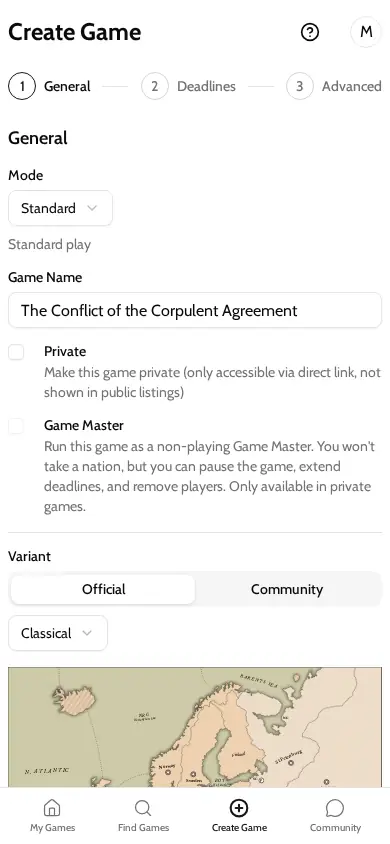

[Desktop](screenshots/create-game-desktop.webp). Step 1 of the Create Game form: mode, game name, Private and Game Master checkboxes, and variant. The user fills the form and moves on to deadlines and advanced settings. **No step mentions bots or AI players** (grep finds no "bot" or "AI player" in `packages/web/src/screens/Home/CreateGame.tsx`). A bot game is a normal game with bots added afterwards (§4.1).

### 7.2 Game info with "Add AI player"

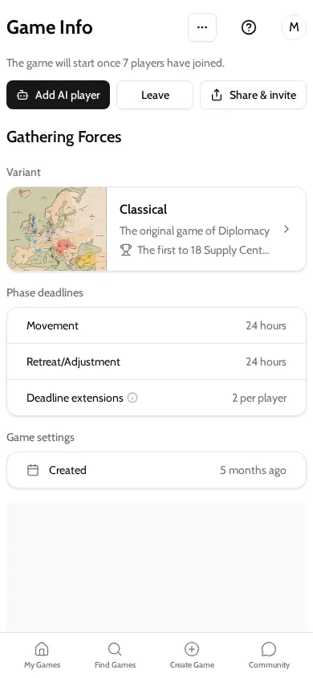

[Desktop](screenshots/game-info-pending-bot-desktop.webp). Game Info for a pending game the user created. Under "The game will start once 7 players have joined" are three buttons: **Add AI player**, Leave, and Share & invite. Below them are the game's variant, deadlines and settings. Game Info does not list the players or say whether bots are already seated. The button only appears for an allowlisted admin with open seats (`packages/web/src/screens/Home/GameInfo.tsx:98-122`).

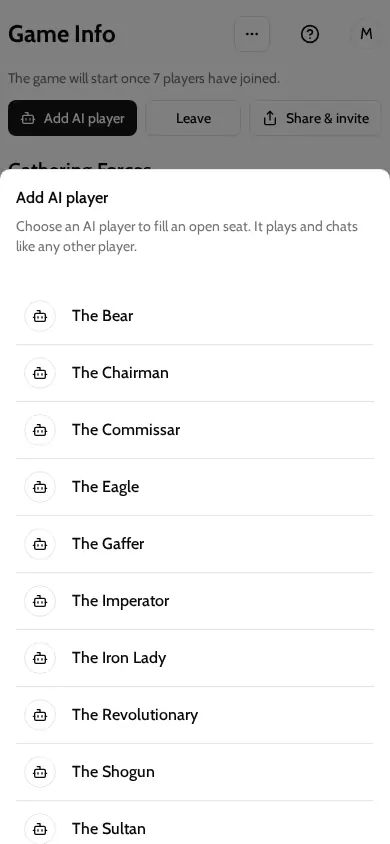

[Desktop](screenshots/add-ai-player-sheet-desktop.webp). The "Add AI player" sheet, a bottom sheet on mobile and a side sheet on desktop. Its description reads "Choose an AI player to fill an open seat. It plays and chats like any other player." Below is a list of bot names, each with a robot icon. Tapping a name seats that bot at once and shows the toast "<name> joined the game" (`packages/web/src/components/AddBotSheet.tsx:35-53`, `:117-122`). The sheet does not say which bots are LLM and which are DumbBots, even though DumbBots never chat. It gives no strength, cost or style. If every bot is already seated, it shows "No AI players available" (`:55-62`).

### 7.3 Lobby with bots seated

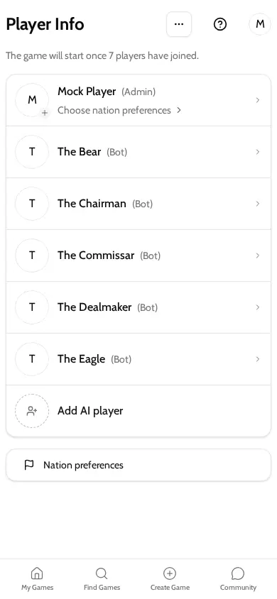

[Desktop](screenshots/lobby-bots-only-desktop.webp). Player Info for a pending game with the creator plus five bots. Each bot row shows the name and "(Bot)". The open seat reads "Add AI player" with a plus icon, and tapping it opens the sheet (`packages/web/src/components/PlayerInfoContent.tsx:344-358`, `:494-518`). The creator can also set nation preferences. Bots have none.

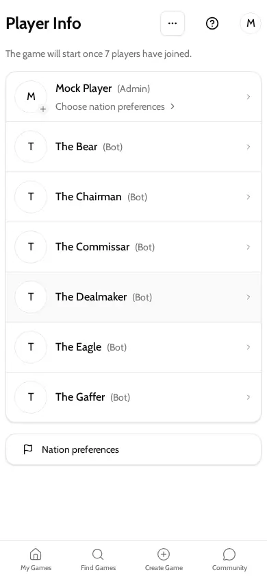

[Desktop](screenshots/lobby-after-adding-bot-desktop.webp). The same lobby after the creator adds "The Gaffer" to the last seat: seven rows, six marked "(Bot)". **In the real app, filling the last seat starts the game immediately** (`service/common/views.py:71-78`). The mock does not start games, so this screen still reads as pending. A real user would see the game move to active.

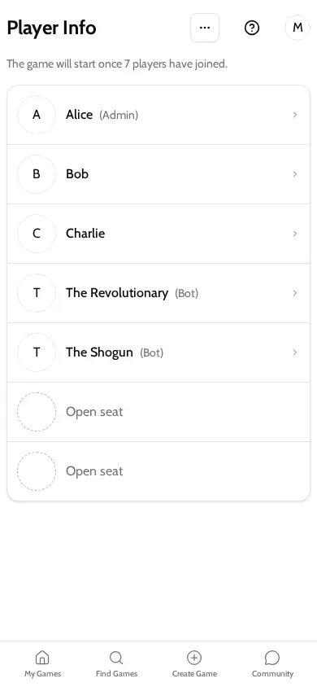

[Desktop](screenshots/lobby-joinable-bots-desktop.webp). The lobby of a public pending game the viewer has not joined. It shows three humans, two bots marked "(Bot)", and two plain "Open seat" rows. This is also what an admin who is not allowlisted sees for open seats.

### 7.4 Find games and game info before joining

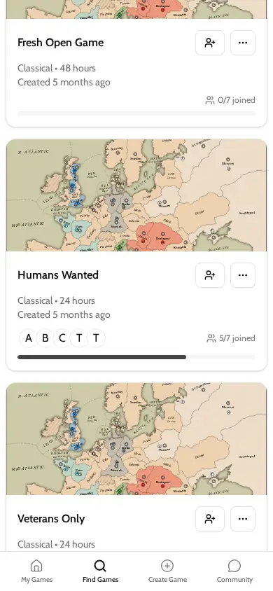

[Desktop](screenshots/find-games-desktop.webp). Find Games with the card for "Humans Wanted", a public game with 3 humans and 2 bots. The card shows "5/7 joined" and five initial avatars: A, B, C, T, T. **Nothing marks the two bots.** They count as joined players and show the initial of "The …" (`packages/web/src/components/GameCard.tsx:478-491`). The user can tap Join or open the card.

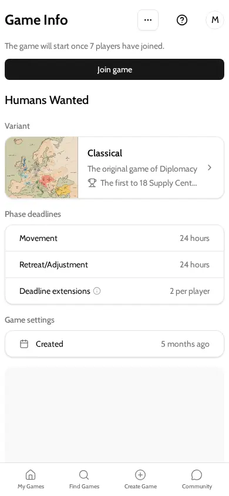

[Desktop](screenshots/game-info-joinable-bots-desktop.webp). Game Info for the same game, with a "Join game" button, the variant, deadlines and settings. **It does not mention bots.** A player learns there are bots only from the Player Info lobby (§7.3) or once in the game.

### 7.5 In-game player list after a bot replacement

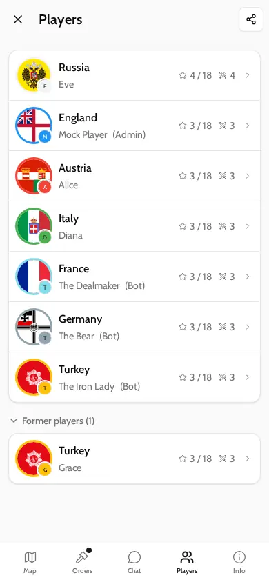

[Desktop](screenshots/game-players-bots-desktop.webp). The in-game Players list. France is "The Dealmaker (Bot)", Germany is "The Bear (Bot)", and Turkey is "The Iron Lady (Bot)". The "Former players (1)" section shows Grace, the human who held Turkey before the bot replaced her. Each row shows supply centres out of 18 and units. The former player's row shows Turkey's current counts, because the client counts by nation. Nothing says that Turkey changed hands to a bot or when. The user can tap any row for details.

### 7.6 Player details

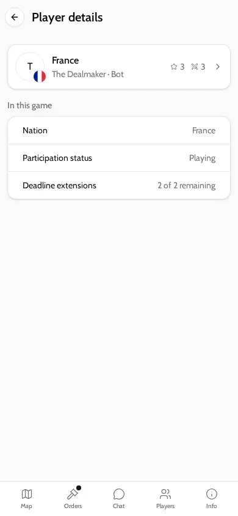

[Desktop](screenshots/member-bot-desktop.webp). Player details for France, subtitled "The Dealmaker · Bot" (`packages/web/src/screens/GameDetail/MemberScreen.tsx:37-42`). It shows Nation, Participation status "Playing" and Deadline extensions. The mock shows "2 of 2 remaining"; the real figure is the game's allowance. **No actions are offered.** The admin cannot remove a bot (§5.4). Tapping the card opens the bot's profile.

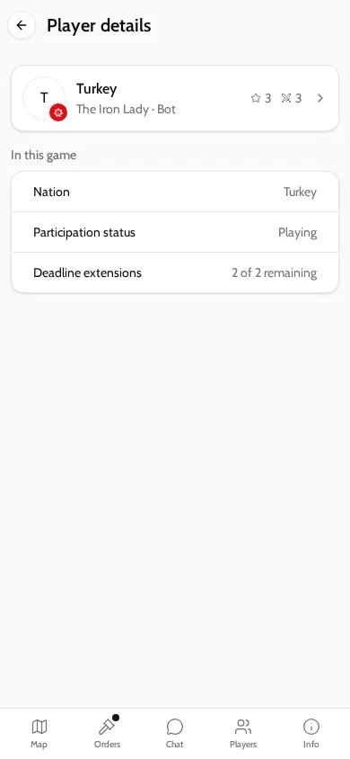

[Desktop](screenshots/member-bot-replacement-desktop.webp). Player details for Turkey, "The Iron Lady · Bot", status "Playing". The screen does not say this bot replaced a human.

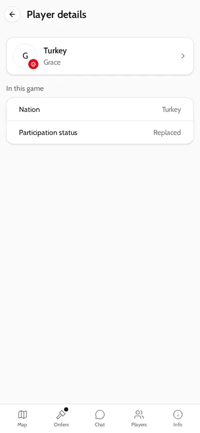

[Desktop](screenshots/member-replaced-by-bot-desktop.webp). Player details for the replaced human, Grace, with Nation "Turkey" and Participation status "Replaced". It does not say who replaced her, whether that was a bot, or why.

### 7.7 Orders and map

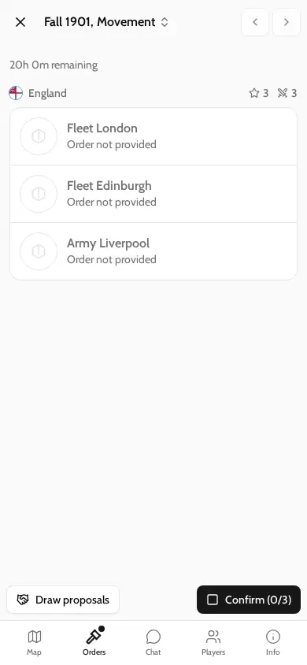

[Desktop](screenshots/game-orders-bots-desktop.webp). The Orders screen for the viewer's nation (England) in Fall 1901: three units with "Order not provided", a Confirm (0/3) button and Draw proposals. The desktop capture shows the map beside the list. **Neither the orders panel nor the map shows which nations are bots or whether bots have already ordered.** Because bots confirm the moment the last human does (§2.4), the phase can resolve seconds after this user taps Confirm.

### 7.8 Chat and press

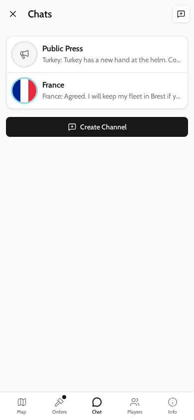

[Desktop](screenshots/chat-list-bots-desktop.webp). The chat list with Public Press and a private channel named "France". The previews read "Turkey: Turkey has a new hand at the helm…" and "France: Agreed. I will keep my fleet…". The user can open a channel or create one.

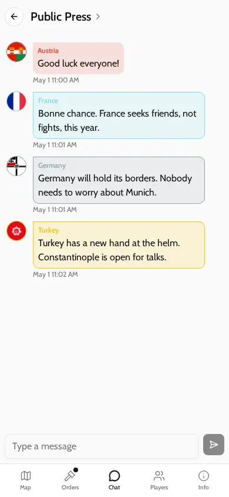

[Desktop](screenshots/chat-public-press-bots-desktop.webp). Public Press with one human (Austria) and three bot messages (France, Germany, Turkey). Each is labelled only with the nation and its flag. **Chat never marks a bot sender.** The API sends `isBot` on the sender (`service/channel/serializers.py:20-22` extends `BaseMemberSerializer`), but the chat screen does not use it (`packages/web/src/screens/GameDetail/ChannelScreen.tsx:164-180`). The message text is fixture copy. In production every human message in a channel triggers one reply per LLM bot in it (§3).

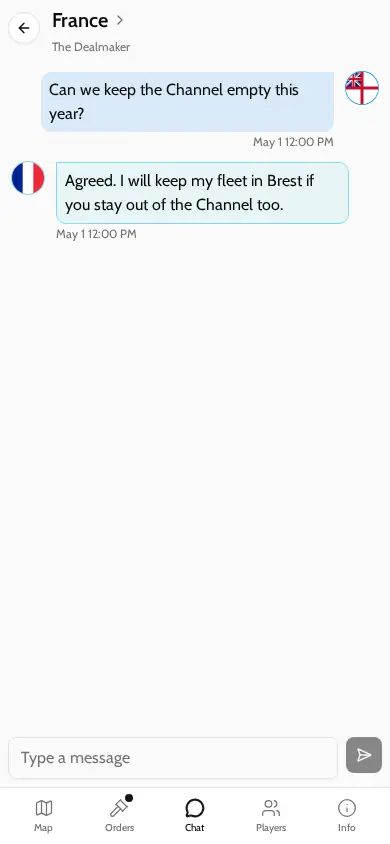

[Desktop](screenshots/chat-private-bot-desktop.webp). A private channel between England and France. The header reads "France", with the player name "The Dealmaker" underneath (desktop). The bot replies within seconds of each human message, without any delay or typing cadence (§9).

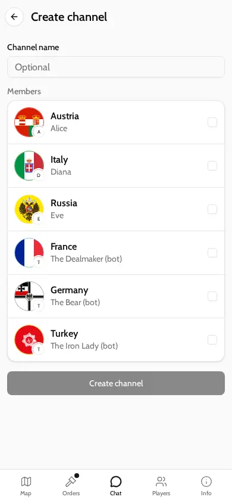

[Desktop](screenshots/chat-create-channel-bots-desktop.webp). Create channel. The member picker lists each nation with its player. Bots carry a lowercase "(bot)" suffix, for example "The Dealmaker (bot)" (`packages/web/src/screens/GameDetail/ChannelCreateScreen.tsx:57-59`). This is the only press screen that identifies bots. The picker does not say that a DumbBot will never answer.

### 7.9 Draw proposal

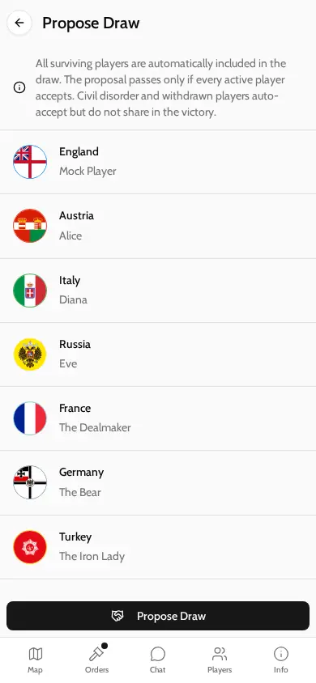

[Desktop](screenshots/propose-draw-bots-desktop.webp). Propose Draw. The text says every surviving player is included and the proposal passes only if every active player accepts. CD and withdrawn players auto-accept. The list shows each nation and player, with the bots unmarked. **Bots never vote**, so the "Propose Draw" button at the bottom creates a proposal that cannot pass (§5.4). Nothing on the screen says so.

### 7.10 A bot's profile

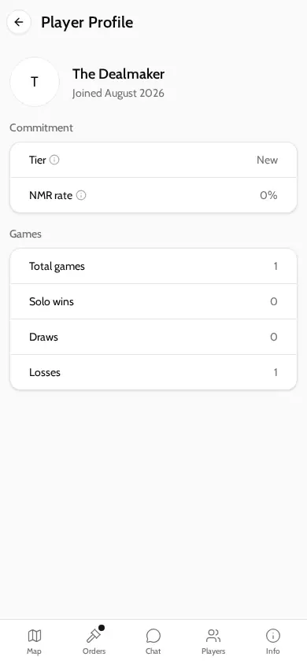

[Desktop](screenshots/bot-profile-desktop.webp). The profile page for "The Dealmaker": name, "Joined August 2026", a Commitment card with Tier and NMR rate, and a Games card with totals, solo wins, draws and losses. The numbers come from a mock and are illustrative. **The page does not say this is a bot.** The public profile API does not expose `kind` (`service/user_profile/serializers.py:54-72`). A bot's tier and stats render the same as a human's.

### 7.11 Admin removing a player

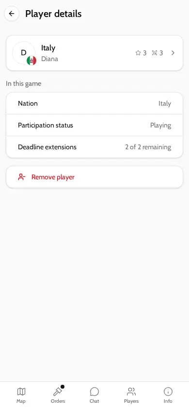

[Desktop](screenshots/remove-player-member-desktop.webp). As admin, viewing Italy (a human who missed orders). The screen has a red "Remove player" action. The equivalent bot screen (§7.6) has none.

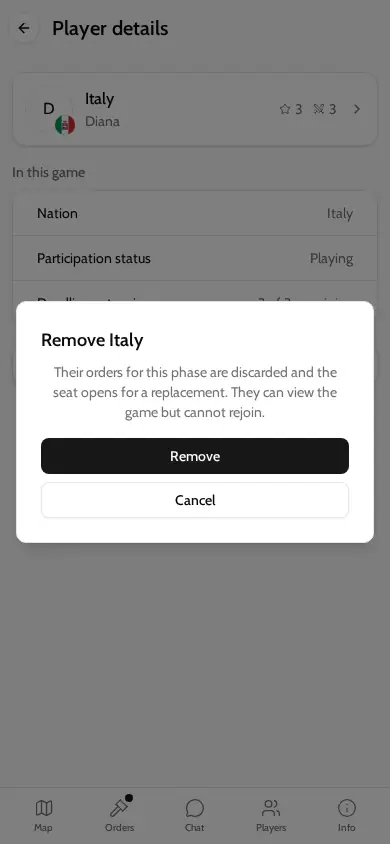

[Desktop](screenshots/remove-player-confirm-desktop.webp). The confirmation dialog "Remove Italy": "Their orders for this phase are discarded and the seat opens for a replacement. They can view the game but cannot rejoin." The buttons are Remove and Cancel. **No option exists to replace the removed player with a bot.** The seat opens only for a human takeover.

### 7.12 A vacant seat offered for takeover

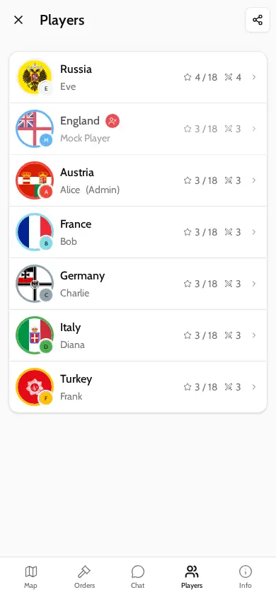

[Desktop](screenshots/cd-seat-player-list-desktop.webp). The Players list in a game where the viewer (England) is in civil disorder. A red CD badge sits next to England. Nothing here offers a bot.

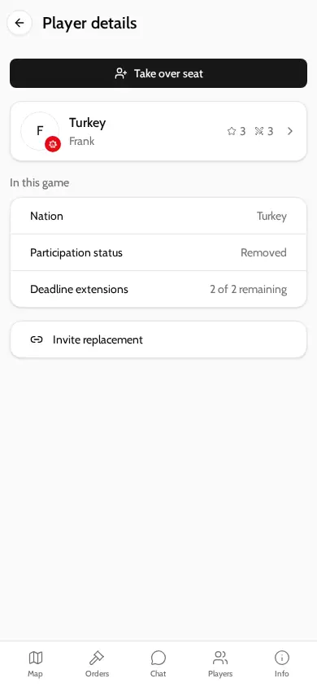

[Desktop](screenshots/member-takeover-open-desktop.webp). A non-member viewing the vacant Turkey seat. A "Take over seat" button sits at the top, and "Invite replacement" (share link) at the bottom.


[Desktop](screenshots/takeover-landing-desktop.webp). The takeover-link landing page, "Replace Player". It shows Turkey, the reason ("Removed from the game by the game creator."), supply centres, the current phase and time left, the press type, and a "Join as Turkey" button. Humans only.

### 7.13 Locked states

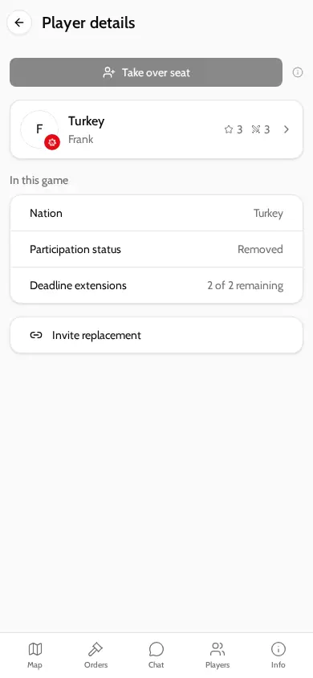

[Desktop](screenshots/member-takeover-locked-desktop.webp). The same seat in a "committed" game, seen by a player who does not meet the requirement. "Take over seat" is greyed out with an info icon. The icon explains: "Your commitment rating does not meet this game's requirement." (`packages/web/src/components/actionDisplay.ts:125-126`).

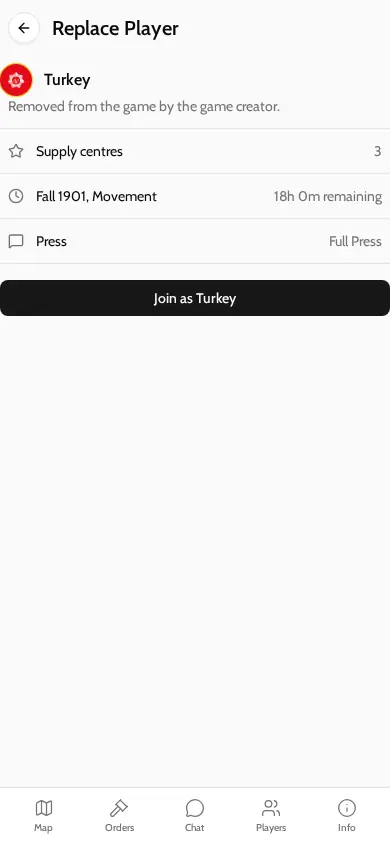

[Desktop](screenshots/takeover-locked-desktop.webp). The takeover landing page for the locked seat, which is **identical to the unlocked one**: "Join as Turkey" is active. The landing screen ignores the block (`packages/web/src/screens/GameDetail/ReplaceScreen.tsx:186-195`), so the user only learns of the lock from the 403 on tap.

**No bot-specific locked state exists.** A user who is not allowlisted simply never sees "Add AI player" (§4.2). The "No AI players available" sheet state (§7.2) was not captured, because the fixtures do not seat all 21 bots.

### 7.14 States not captured

- **A game that started when the last bot was added.** The mock does not start games (§7.3).
- **Notifications and emails.** Push notifications cannot be rendered by the mock. No email mentions bots (§5.7).
- **Native iOS and Android.** Not run (see the start of §7).
- **"Seat already taken by a bot" on the takeover link.** The only route into that state in the mocks is as a member of the game, which renders "Already playing" instead.

---

## 8. Known problems and gaps

These come from writing this document. None are owner-raised.

1. **Bot games are not available to players.** One allowlisted email (§4.2, §6.5). Recovery through bot games depends on removing this gate (owner decisions §8).
2. **No player path to bot replacement.** Only the shell command (§4.3), which notifies nobody and erases the replaced player's history for that game from their score (§5.1).
3. **Draws cannot pass with a bot at the table** (§5.4). Production has two stranded proposals.
4. **Games with bots never abandon and have no end condition other than a solo** (§5.6). For LLM bots this is open-ended token spend **(unverified in production)**.
5. **Admin can pass to a bot** (§5.7) **(inferred)**.
6. **Bots are not marked where players form judgements:** Find Games, Game Info, chat senders, draws and profiles (§7). Anonymous games do the opposite: bots stay named while humans are masked (§5.2).
7. **The bot picker does not distinguish kinds.** A DumbBot is described as playing and chatting "like any other player", but it never chats (§7.2).
8. **Instant confirmation can surprise humans.** The phase resolves the moment the last human confirms (§2.4). Nothing in the UI says bots are waiting on you.
9. **Failures are invisible.** Fallback orders count as success, and `inference_inference` is empty in production (§6.6).
10. **LLM reply fan-out.** Every human message triggers one reply per LLM bot in the channel, with no delay, and bots never initiate or talk to each other (`service/agent/registry.py:72-87`). Issue #1130 decided on addressed replies, probability-gated replies and delay bands. That cadence is not in the code (no `schedule_at`, delay or probability logic in `service/agent/`; grep).
11. **The LLM bot plays weaker than the DumbBot** in the only recorded match, and the benchmark from #1126 has not been reported as passed (§3).
12. **Finalize repeats the model call** that plan already made (§2.4). This doubles LLM order cost per phase when humans confirm early.
13. **Dormant scaffolding:** `Member.seeking_replacement` is never set (§4.5).
14. **Bots in public press always reply to humans,** including in public games where other humans did not ask for bots (§4.1).

### Related issues and pull requests

- #166: Civil Disorder auto-pilot for inactive players (closed).
- #1125: Map, make the AI player worth playing against. Closed as not planned; all 6 sub-issues are closed. Its decisions: #1126 (benchmark against DumbBot), #1127 (agent memory reference), #1130 (who speaks and when), #1131 (persona roster, neutral in production).
- #987: Bots don't recognise illegal moves described in chat (closed).
- Pull requests that shaped the current system: #908 and #910 (walking skeleton: seating, plan and finalize), #951 (add AI players from the roster), #1110 (durable AgentTask), #1116 and #1120 (`replace_member_with_bot`), #1117 (DumbBot), #1122 (re-plan command and admin action), #1135 (no personas in prompts), #1137 (finalize when no human can order), #1208 (bot identity on `UserProfile`), #1407 and #1553 (evals), #1573 (DumbBot convoy fix).
- Open PRs touching bots: none found by search.

---

## 9. Open questions for the redesign

These are decisions the current code makes implicitly. A UX design should settle each one explicitly.

1. **Who may start a bot game, and from where?** Today: an allowlisted admin, after creation, from the lobby. Should "play against bots" be its own entry point, a creation option, or both?
2. **Which bot kind, and does the player choose?** Today the player picks a named persona from a mixed list, with no indication of kind, strength or chattiness.
3. **Mixed tables.** May bots sit in public games alongside strangers? Do joiners see that before they join, on the card and in Game Info?
4. **Pace.** Should bots wait for humans and then resolve instantly, as today? Should a bot-only recovery game have its own short deadlines?
5. **Replacement policy.** When a seat goes vacant (CD, removal, withdrawal, muster no-show), who can bring in a bot: the admin, any remaining player, a vote, or automatic after a delay? Does a bot hold the seat only until a human takes over, or permanently?
6. **Disclosure on replacement.** What do the other players, and the replaced player, get told? Today the command says nothing.
7. **Labelling.** Should a bot be marked everywhere it appears: chat, cards, draws, profile? How does that interact with anonymous games, where bots are currently the only named players?
8. **Draws.** Should bots vote, auto-accept, or be excluded the way vacant seats are?
9. **Game end.** How does a game end when only bots remain? Abandon, end immediately, or play on?
10. **Admin.** Can a bot ever hold the admin role?
11. **Commitment.** Owner decisions §2.4 says bot games count up to a cap. The current code scores bot games only if they are public, and a `low` player cannot create one. The design must say which games count, and whether a replacement by a bot counts as abandonment for the player who left.
12. **Press.** Should bots talk at all in recovery games? How often, to whom, and are DumbBots explicitly silent?
13. **Failure visibility.** What, if anything, does a player see when a bot falls back to default orders?
14. **Cost envelope.** With an open audience, what per-game token budget is acceptable, and what happens when it is exhausted?

---

## 10. What could not be verified

- Why `inference_inference` is empty in production despite 275 agent tasks (§6.6).
- LLM per-call token counts, cost and latency in production (§3, §6.6).
- The Anthropic SDK timeout and retry defaults for the installed version (§2.5).
- Whether a bot can enter NMR or CD in practice (§2.5).
- Whether a game whose humans have all left keeps resolving with bots until a solo (§5.6).
- Whether admin can actually be reassigned to a bot (§5.7).
- Whether notifications to bot users are dropped for lack of devices, and whether bots can post in no-press games (§5.2, §5.7).
- Native iOS and Android rendering. Only the shared web bundle was captured (§7).
- Whether any bot game was created and then deleted while pending, which would leave no rows (§6.2).

---

## Appendix A: key files

| Concern | File |
| --- | --- |
| Bot identity, addable bots | `service/user_profile/models.py`, `service/common/constants.py` (`UserKind`) |
| Roster seed | `service/user_profile/migrations/0009_seed_bot_roster.py` |
| Allowlist | `service/user_profile/utils.py` (`user_can_use_bot_opponent`), `service/project/settings.py`, `service/common/permissions.py` (`CanUseBotOpponent`) |
| Seating and replacement | `service/member/views.py`, `service/member/serializers.py`, `service/member/models.py` (`hand_over_seat`, `actions_for`) |
| Event → task wiring | `service/emit/dispatch.py`, `service/agent/registry.py` |
| Task execution, fallback | `service/agent/tasks.py`, `service/agent/models.py`, `service/agent/fallback.py` |
| LLM calls and logging | `service/agent/orchestration.py`, `service/inference/` |
| Prompts | `service/harness/tasks/select_orders/`, `service/harness/tasks/reply/` |
| DumbBot | `service/dumbbot/policy.py` |
| Staff tools | `service/agent/management/commands/replace_member_with_bot.py`, `replan_member.py`, `service/member/admin.py` |
| Game rules touching bots | `service/game/models.py` (`can_remove_member`, `reassign_admin`, `should_abandon`, mustering, `delete_if_empty_pending`), `service/phase/models.py`, `service/draw_proposal/models.py` |
| Evals and matches | `service/harness/tasks/select_orders/EVAL_RESULTS.md`, `service/dumbbot/EVAL_RESULTS.md`, `service/integration/MATCH_RESULTS.md`, `evals/plan.md` |
| Web UI | `packages/web/src/components/AddBotSheet.tsx`, `PlayerInfoContent.tsx`, `GameCard.tsx`; `packages/web/src/screens/Home/GameInfo.tsx`; `packages/web/src/screens/GameDetail/MemberScreen.tsx`, `ChannelCreateScreen.tsx`, `ChannelScreen.tsx`, `ReplaceScreen.tsx`, `ProposeDrawScreen.tsx` |

## Appendix B: production queries

All read-only, run through pgweb (`/prod-query`) on 2026-10-24. Each block was run on its own.

```sql
-- A. users by kind
SELECT kind, count(*) FROM user_profile_userprofile GROUP BY 1 ORDER BY 1;

-- B. games that have ever had a bot player
WITH bg AS (
  SELECT g.id, g.status, g.private, g.sandbox, g.anonymous, g.created_at,
    count(*) FILTER (WHERE up.kind <> 'human') AS bot_seats,
    count(*) FILTER (WHERE up.kind = 'human') AS human_seats,
    bool_or(up.kind='llm') AS has_llm, bool_or(up.kind='dumbbot') AS has_dumb
  FROM game_game g JOIN member_member m ON m.game_id=g.id AND m.kind='player'
  LEFT JOIN user_profile_userprofile up ON up.user_id=m.user_id
  GROUP BY g.id HAVING count(*) FILTER (WHERE up.kind <> 'human') > 0
)
SELECT status, private, sandbox, anonymous, has_llm, has_dumb, count(*), sum(bot_seats) bot_seats,
       sum(human_seats) human_seats, min(created_at)::date, max(created_at)::date
FROM bg GROUP BY 1,2,3,4,5,6 ORDER BY 1,2;

-- C. bot members over time
SELECT up.kind, m.kind AS member_kind, g.status, g.private, g.sandbox,
  date_trunc('month', m.created_at)::date AS month,
  count(*) AS bot_members,
  count(*) FILTER (WHERE m.removed_at IS NOT NULL) removed,
  count(*) FILTER (WHERE m.civil_disorder_at IS NOT NULL) cd,
  count(*) FILTER (WHERE m.eliminated_at IS NOT NULL) eliminated,
  count(*) FILTER (WHERE m.replaced_by_id IS NOT NULL) replaced,
  count(DISTINCT g.id) games
FROM member_member m JOIN user_profile_userprofile up ON up.user_id=m.user_id
JOIN game_game g ON g.id=m.game_id
WHERE up.kind <> 'human' GROUP BY 1,2,3,4,5,6 ORDER BY 6,1;

-- D. replacements by replacement kind and old seat state
SELECT up_new.kind AS replacement_kind, (old.civil_disorder_at IS NOT NULL) AS old_was_cd,
  (old.withdrawn_at IS NOT NULL) AS old_withdrew, (old.removed_at IS NOT NULL) AS old_removed,
  date_trunc('month', new.created_at)::date AS month, count(*)
FROM member_member old JOIN member_member new ON new.id=old.replaced_by_id
LEFT JOIN user_profile_userprofile up_new ON up_new.user_id=new.user_id
GROUP BY 1,2,3,4,5 ORDER BY 5,1;

-- E. bot phase states and outcomes
SELECT up.kind, count(*) phase_states, count(*) FILTER (WHERE ps.has_possible_orders) with_orders,
  count(*) FILTER (WHERE ps.orders_outcome='received') received, count(*) FILTER (WHERE ps.orders_outcome='nmr') nmr,
  count(*) FILTER (WHERE ps.orders_confirmed) confirmed
FROM phase_phasestate ps JOIN member_member m ON m.id=ps.member_id
JOIN user_profile_userprofile up ON up.user_id=m.user_id WHERE up.kind<>'human' GROUP BY 1;

-- F. agent tasks and inference rows by status
SELECT 'agenttask' src, kind, status, count(*), sum(attempts), min(created_at)::date, max(created_at)::date
FROM agent_agenttask GROUP BY 1,2,3
UNION ALL
SELECT 'inference', task, status, count(*), NULL, min(created_at)::date, max(created_at)::date
FROM inference_inference GROUP BY 1,2,3
ORDER BY 1,2,3;

-- G. inference tokens and latency (returned 0 rows)
SELECT task, model, count(*), round(avg(input_tokens)) avg_in, round(avg(output_tokens)) avg_out,
  round(avg(cache_read_tokens)) avg_cache_read,
  percentile_cont(0.5) WITHIN GROUP (ORDER BY extract(epoch FROM completed_at-started_at)) p50_s,
  percentile_cont(0.9) WITHIN GROUP (ORDER BY extract(epoch FROM completed_at-started_at)) p90_s,
  max(extract(epoch FROM completed_at-started_at)) max_s
FROM inference_inference WHERE status='succeeded' GROUP BY 1,2;

-- H. inference rows, bot app migration dates, bot messages, bot commitment
SELECT 'inference_rows', count(*)::text FROM inference_inference
UNION ALL SELECT app||'.'||name, applied::date::text FROM django_migrations
  WHERE app IN ('inference','agent','dumbbot') OR (app='user_profile' AND name LIKE '00%bot%')
     OR (app='user_profile' AND name LIKE '0007%')
UNION ALL SELECT 'msgs_by_bots', count(*)::text FROM channel_channelmessage cm
  JOIN member_member m ON m.id=cm.sender_id JOIN user_profile_userprofile up ON up.user_id=m.user_id
  WHERE up.kind<>'human'
UNION ALL SELECT 'bot_profile_commitment_'||commitment, count(*)::text FROM user_profile_userprofile
  WHERE kind<>'human' GROUP BY commitment;

-- I. agent tasks with errors
SELECT 'agenttask_rows', count(*)::text FROM agent_agenttask
UNION ALL SELECT 'agenttask_with_error', count(*)::text FROM agent_agenttask WHERE last_error <> '';

-- J. notifications to bots, bot game phases, victory, draw votes by bots
SELECT 'notifications_to_bots', count(*)::text FROM notification_notification n
  JOIN user_profile_userprofile up ON up.user_id=n.recipient_id WHERE up.kind<>'human'
UNION ALL SELECT 'bot_game_phases_completed', count(*)::text FROM phase_phase p
  WHERE p.status='completed' AND p.game_id IN (SELECT m.game_id FROM member_member m
    JOIN user_profile_userprofile up ON up.user_id=m.user_id WHERE up.kind<>'human')
UNION ALL SELECT 'bot_game_victory_type', coalesce((SELECT CASE WHEN count(*)>1 THEN 'draw' ELSE 'solo' END
  FROM victory_victory_members vm JOIN victory_victory v ON v.id=vm.victory_id
  WHERE v.game_id IN (SELECT m.game_id FROM member_member m
    JOIN user_profile_userprofile up ON up.user_id=m.user_id WHERE up.kind<>'human')), 'none')
UNION ALL SELECT 'bot_is_victor', count(*)::text FROM victory_victory_members vm
  JOIN member_member m ON m.id=vm.member_id JOIN user_profile_userprofile up ON up.user_id=m.user_id
  WHERE up.kind<>'human'
UNION ALL SELECT 'draw_votes_by_bots_'||coalesce(dv.accepted::text,'null'), count(*)::text
  FROM draw_proposal_drawvote dv JOIN member_member m ON m.id=dv.member_id
  JOIN user_profile_userprofile up ON up.user_id=m.user_id WHERE up.kind<>'human' GROUP BY dv.accepted;

-- K. draw proposals in games with bots
SELECT dp.id, dp.cancelled_at IS NOT NULL AS cancelled,
  count(*) FILTER (WHERE dv.accepted IS TRUE) acc, count(*) FILTER (WHERE dv.accepted IS FALSE) rej,
  count(*) FILTER (WHERE dv.accepted IS NULL) pending,
  count(*) FILTER (WHERE dv.accepted IS NULL AND up.kind<>'human') pending_bot
FROM draw_proposal_drawproposal dp JOIN draw_proposal_drawvote dv ON dv.proposal_id=dp.id
JOIN member_member m ON m.id=dv.member_id LEFT JOIN user_profile_userprofile up ON up.user_id=m.user_id
WHERE dp.game_id IN (SELECT m.game_id FROM member_member m
  JOIN user_profile_userprofile up ON up.user_id=m.user_id WHERE up.kind<>'human')
GROUP BY 1,2;

-- L. notification retention window
SELECT count(*), min(created_at)::date FROM notification_notification;
```

**Railway check** (allowlist and model settings), run with the project token and reporting only counts and whether each variable is set:

```bash
railway variables --service <diplicity-react|diplicity-worker> --json \
  | python3 -c "...print entry count of BOT_OPPONENT_ALLOWLIST, whether BOT_ANTHROPIC_API_KEY is set, BOT_LLM_MODEL..."
```
